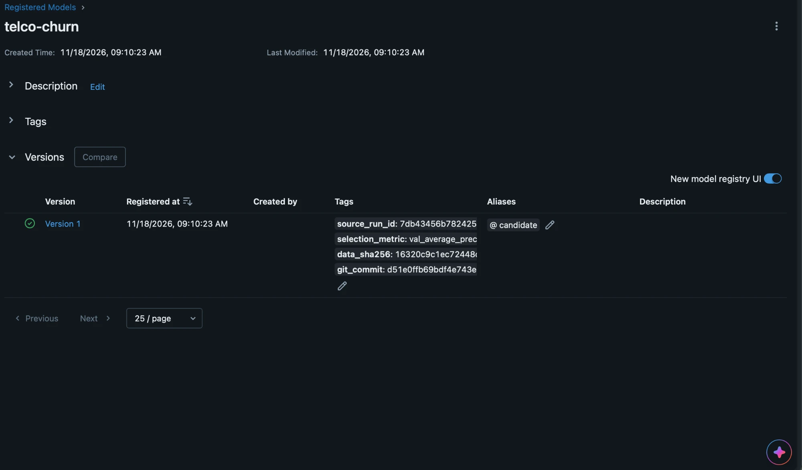

# TP03 summary: track, compare and recover ML experiments with MLflow

**Students:** Sarah Chammari and Shaima Kraiem
**MLflow:** 3.18.0 (pinned in `uv.lock`) · **Experiment:** `telco-churn-tp03` · **Tracking server:** local, `http://127.0.0.1:5000`
**Code commit used for the runs:** `d51e0ffb69bdf4e743ed9019d99f6cf20fe2b661` (no uncommitted changes at run time)

## 1. Candidate comparison


Same six features, same TP02 customer allocation (seed 42, 60/20/20), same evaluation (validation only, threshold 0.5). Exported with `scripts/tracking_status.py` (`evidence/tp03/search_runs.csv`).

| Run ID | Candidate / setting | Validation AP | Validation recall | Validation F1 | Decision |
|---|---|---:|---:|---:|---|
| `7db43456b782425ea7b2cc3db086b1b0` | `forest-300trees-depth8` (RF, 300 trees, max_depth 8, min_samples_leaf 10) | **0.6639** | 0.4840 | 0.5561 | **Selected** |
| `faae1bdf0aba4e7f8141f143fa0c267f` | `logistic-C1` (logistic regression, C=1, max_iter 1000) | 0.6475 | 0.5294 | 0.5893 | Not selected |
| `bb180cefda2d430783618894572fd04d` | `tree-depth5-leaf20` (decision tree, max_depth 5, min_samples_leaf 20) | 0.6173 | 0.6016 | 0.6181 | Not selected |
| `e9b2059c37594370952b4956de435c78` | `baseline-majority` (always "No churn") | 0.2654 | 0.0000 | 0.0000 | Reference only |

**Selection.** The rule was fixed in TP02 before any result: highest validation average precision, but a simpler model is kept if it is within 0.005 of the best. The random forest has the best AP (0.6639). The logistic regression is 0.0164 below, more than the 0.005 margin, so the simplicity rule does not apply and the random forest is selected. It has a lower recall and F1 than the other models at threshold 0.5, but these are supporting metrics: AP measures the ranking of churners independently of the threshold, and the threshold was not changed after seeing the results. This is one validation split, so the gap is not proof of a statistically significant improvement. The test set was not used.

## 2. Selected run


The run page shows the `clf.*` parameters, `split_seed`, `threshold`, the `val_*` metrics, the tags `git_commit` / `data_sha256` / `split_allocation_sha256`, the artifacts `evaluation/val_confusion_matrix.png` and `provenance.json`, and the dataset records `telco_train` (context `training`) and `telco_validation` (context `validation`).

Input schema stored with the model (inferred from `X_train.head(3)`): `tenure`, `MonthlyCharges`, `TotalCharges` as `double`; `Contract`, `InternetService`, `PaymentMethod` as `string`; output `long` (class 0/1). It describes the raw input columns expected by the pipeline, not the internal one-hot encoding. Note: the schema marks the columns as required, while `validate_features` allows a blank `TotalCharges` (it becomes NaN and is imputed). This only matters for pyfunc schema enforcement; `mlflow.sklearn.load_model` returns the plain scikit-learn pipeline.

## 3. Registry



## 4. Identifiers

| Item | Value | Question it answers |
|---|---|---|
| Source run ID | `7db43456b782425ea7b2cc3db086b1b0` | Which execution produced the model? |
| Logged model URI | `models:/m-7bac82e966864855815d5c34789d1d28` | Which recorded model artifact to load? |
| Registered model / version | `telco-churn` version **1** | Which version of the managed model? |
| Alias | `candidate` → version 1 | Which version is currently selected for this role? |
| Git commit | `d51e0ffb69bdf4e743ed9019d99f6cf20fe2b661` | Which code? |
| Original CSV SHA-256 | `16320c9c1ec72448db59aa0a26a0b95401046bef5d02fd3aeb906448e3055e91` | Which data bytes? |
| Split allocation SHA-256 | `a981175e5fa0ef378bc7cea8b18f5db669157ad01a9f532239e30514bc791f16` (`evidence/tp02/split_allocation.csv`) | Which train/validation/test customers? |

All values are also in `evidence/tp03/handover.json`.

## 5. Fresh-process inference

Command, run in a new terminal process with the tracking server running:

```sh
uv run python scripts/predict_registered.py --input evidence/tp03/inference_batch.csv --reference evidence/tp03/reference_predictions.csv
```

The script loads `models:/telco-churn@candidate`, applies the TP02 boundary rules (`validate_features`), does not call `fit` and does not import training code. The reference scores were produced by the in-memory fitted pipeline at the end of `train_tracked.py`, on the same 20 validation customers.

```
models:/telco-churn@candidate -> version 1 (source run 7db43456b782425ea7b2cc3db086b1b0)
Rows: 20 | classes agree: True | max |score diff|: 8.500e-17 (tolerance 1e-09) -> AGREEMENT OK
```

Full output: `evidence/tp03/inference_before_restart.txt`.

Loading in a new process is stronger evidence than predicting again in the training session: there, the fitted object is still in memory with all its imports. A new process proves that everything needed is actually stored and recoverable from the registry without refitting.

If the alias later points to a new version, an already-loaded Python object does **not** change: it is an in-memory copy. `load_model("models:/telco-churn@candidate")` must be called again (for example by restarting the service) to get the new version, which is why the version number is recorded with the alias.

## 6. Restart observation

The server was stopped (`curl /health` → no answer, `mlflow.db` and `mlartifacts/` still on disk) and restarted from the project root with the same command.

- **Before:** 5 runs in `telco-churn-tp03` (1 smoke test + 4 candidate/baseline), `telco-churn` versions [1], `candidate` → version 1.
- **After:** identical (`evidence/tp03/status_before_restart.txt` and `status_after_restart.txt` are the same), and the inference command gave the same 20 predictions with `AGREEMENT OK`.

**What do the database and artifact store each preserve?**
- `mlflow.db` (backend store): experiments, runs, parameters, metrics, tags, dataset records, registered models, versions and aliases. It is the index and the history, without the files.
- `mlartifacts/` (artifact store): the model files (`MLmodel`, `model.pkl`, `requirements.txt`, `python_env.yaml`, input example), the confusion matrices and `provenance.json`.
- If only the database survived, every run, metric and alias would still be visible, but loading the model (and opening the confusion matrices or provenance) would fail. If only the model files survived, a model folder could still be loaded directly, but its parameters, metrics, tags, dataset records, run ↔ model link, versions and alias would be lost.

**What must a colleague on another machine obtain separately?** `127.0.0.1` and our run IDs mean nothing on their machine. They need access to a shared tracking server, or a copy of **both** `mlflow.db` and `mlartifacts/`; this repository at commit `d51e0ff`; the `uv.lock` environment (scikit-learn 1.5.2, MLflow 3.18.0); and the original CSV, checked against its SHA-256 (the hash identifies the file, it cannot recreate it).

## 7. Other questions

- **Experiment vs run.** An experiment groups comparable runs on the same problem and protocol; a run is one execution with its own inputs and results. The browser page does not execute the training code: it displays what the training client sent to the server.
- **Metric vs artifact.** A metric is a numeric value stored in the database and comparable across runs; an artifact is a file stored in the artifact store.
- **Two allocations from the same CSV.** The CSV SHA-256 would be identical. What distinguishes them is the hash of the `customerID → split` allocation file, the seed and ratios, and the MLflow dataset digests of the train/validation records (different content gives a different digest).
- **Does a seed guarantee identical results everywhere?** No: library versions, BLAS, OS and parallelism can change results. It reduces variability but does not remove it.
- **Recover the data from its hash?** No. A hash identifies bytes; it does not store them.
- **Commit logged with uncommitted edits?** The commit no longer describes the code that ran, so traceability breaks. This is why the runs record `git_uncommitted_changes`, and why the code was committed (`d51e0ff`) before the final runs.
- **Different validation populations.** The gap would mix the effect of the model with the effect of the sample, so the comparison would not be fair.
- **Repeated selection on the test set.** The test set would become a selection set: its score would be optimistic and no longer an unbiased estimate.
