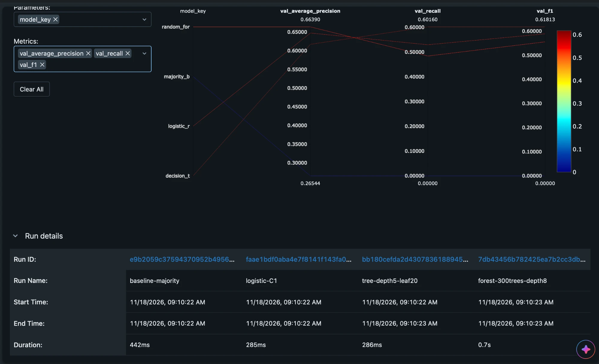
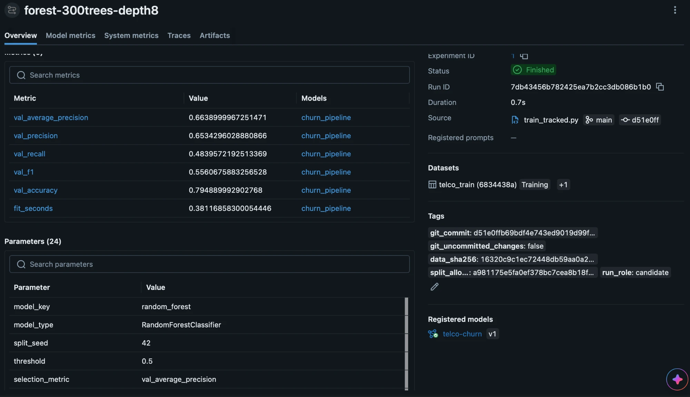

# TP03 summary

**Students:** Sarah Chammari and Shaima Kraiem
**MLflow:** 3.18.0, experiment `telco-churn-tp03`, local server `http://127.0.0.1:5000`
**Answers to the questions:** `evidence/tp03/answers.md`

## 1. Candidate comparison



| Run ID | Candidate | Val AP | Val recall | Val F1 | Decision |
|---|---|---:|---:|---:|---|
| `7db43456b782425ea7b2cc3db086b1b0` | forest-300trees-depth8 | **0.664** | 0.484 | 0.556 | Selected |
| `faae1bdf0aba4e7f8141f143fa0c267f` | logistic-C1 | 0.647 | 0.529 | 0.589 | No |
| `bb180cefda2d430783618894572fd04d` | tree-depth5-leaf20 | 0.617 | 0.602 | 0.618 | No |
| `e9b2059c37594370952b4956de435c78` | baseline-majority | 0.265 | 0.000 | 0.000 | Baseline |

Same features, same split as TP02 (seed 42), same threshold (0.5). We chose with the rule from TP02: best validation AP, unless a simpler model is within 0.005. The random forest is 0.016 above logistic regression, so it is selected. The test set was not used.

## 2. Selected run



The second dataset ("+1" in the UI) is `telco_validation`:

| Dataset | Context | Digest | Rows |
|---|---|---|---:|
| `telco_train` | training | `6834438a` | 4,225 |
| `telco_validation` | validation | `4fb2e5e6` | 1,409 |

(from `evidence/tp03/selected_run_datasets.txt`)

## 3. Registry


## 4. Identifiers

| Item | Value |
|---|---|
| Source run ID | `7db43456b782425ea7b2cc3db086b1b0` |
| Logged model URI | `models:/m-7bac82e966864855815d5c34789d1d28` |
| Registered version | `telco-churn` v1 |
| Alias | `candidate` |
| Git commit | `d51e0ffb69bdf4e743ed9019d99f6cf20fe2b661` |
| Data SHA-256 | `16320c9c1ec72448db59aa0a26a0b95401046bef5d02fd3aeb906448e3055e91` |

## 5. Fresh-process inference

```sh
uv run python scripts/predict_registered.py --input evidence/tp03/inference_batch.csv --reference evidence/tp03/reference_predictions.csv
```

```
models:/telco-churn@candidate -> version 1 (source run 7db43456b782425ea7b2cc3db086b1b0)
Rows: 20 | classes agree: True | max |score diff|: 8.500e-17 (tolerance 1e-09) -> AGREEMENT OK
```

## 6. Restart

We stopped the server and restarted it with the same command. The 5 runs, version 1 and the alias were still there, and the inference gave the same output (`status_before_restart.txt` / `status_after_restart.txt`).

- `mlflow.db` keeps the runs, params, metrics, tags, versions and the alias.
- `mlartifacts/` keeps the model files, confusion matrices and provenance.json.
- A colleague on another machine needs both of them (or a shared server), the code at commit d51e0ff, `uv.lock` and the CSV.
